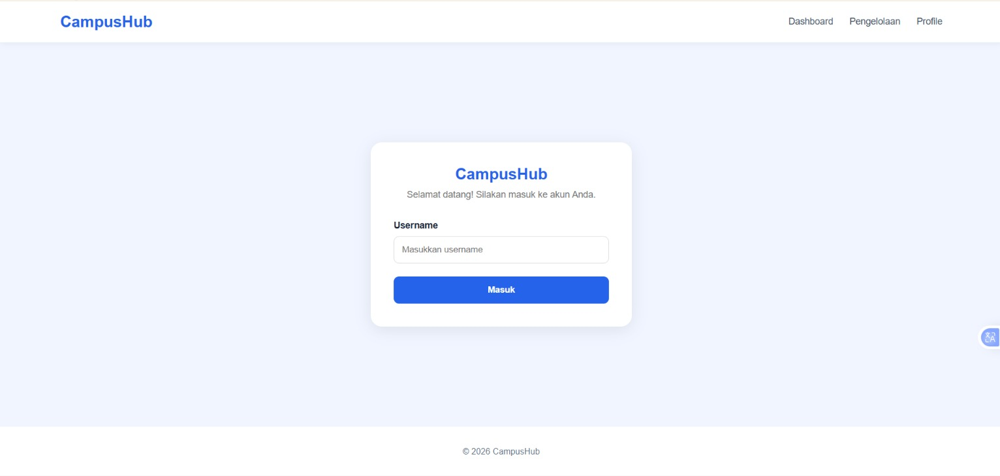

# CampusHub

# Deskripsi
CampusHub merupakan aplikasi web berbasis Laravel yang dirancang untuk membantu mahasiswa dalam mengakses dan mengelola informasi perkuliahan secara sederhana. Website ini menyediakan informasi mengenai mata kuliah serta daftar tugas yang harus dikerjakan mahasiswa, termasuk informasi deadline dan status pengerjaan tugas.

Melalui CampusHub, mahasiswa dapat melakukan login untuk masuk ke halaman dashboard, melihat ringkasan informasi perkuliahan, mengakses daftar mata kuliah, serta melihat detail dari masing-masing mata kuliah. Selain itu, dashboard juga menampilkan daftar tugas beserta status penyelesaiannya sehingga mahasiswa dapat lebih mudah memantau tugas akademik yang dimiliki.

# Fitur fitur yang digunakan
-Login
-Dashboard
-Pengelolaan
-Profile

# Screenshoot Website

## Halaman Login

## Halaman Dashboard

## Halaman Pengelolaan

## Detail Mata Kuliah

## Halaman Profile

